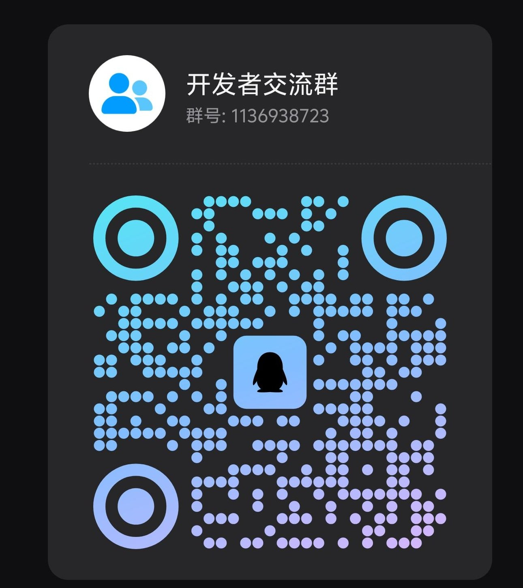
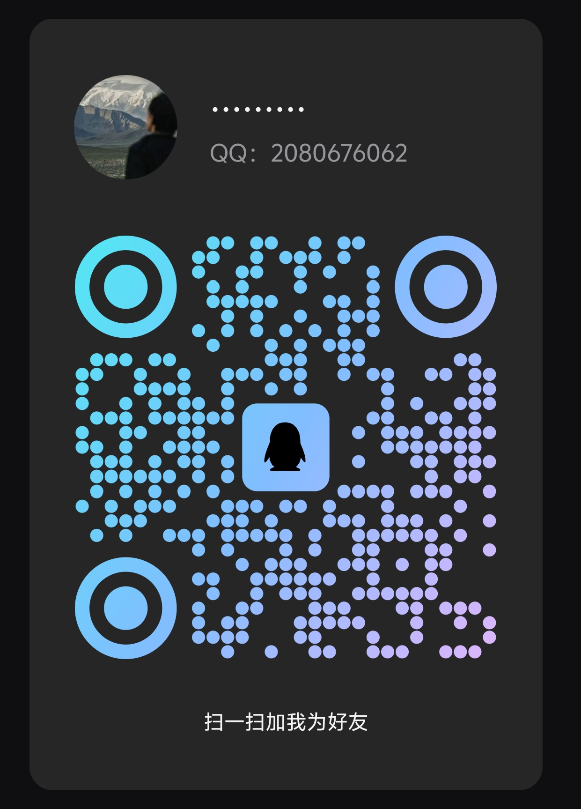

# Yanban (言伴)

English | [简体中文](README.md)

An Android chat app built on the DeepSeek API. The web layer is React + rspack; Capacitor wraps it in an Android WebView. There is no application backend: the browser or the app talks to the configured API service directly.

The chat model can run against either the official DeepSeek API or any Anthropic-compatible endpoint. Speech, document parsing and web search always use the official DeepSeek APIs.

## Why this exists

The official DeepSeek app has usage quotas, so at busy times it queues, answers slowly, or refuses to send at all.

Yanban moves the same chat experience onto *your own* API key: how much you can send is decided by your account rather than by the official app's queue, and the chat model can be pointed at any Anthropic-compatible endpoint (ModelScope, Volcengine Ark, …) so you can pick whichever is cheapest or fastest.

## Features

- Multiple conversations with automatic titles, rename and delete; edit a prompt, regenerate a reply, and switch between branches.
- Streaming replies, deep thinking, stop and continue.
- Smart search and link reading: retrieval goes through the DeepSeek Search / Fetch APIs, and the results are attached to the current turn with sources.
- Attachments: images go straight to the model; PDF, Word and PowerPoint are converted to text by DeepSeek OCR; plain-text and code files are read locally.
- Voice input and read-aloud (ASR / TTS, two voices).
- Markdown, syntax highlighting, KaTeX math and Mermaid diagrams.
- Simplified Chinese and English, light and dark themes, mobile layouts, history import and export.
- In-app update check: compares the GitHub Releases version and hands the download plus system installer to native code.

## Download

Grab the latest APK from [Releases](https://github.com/JiaMingWang-CN/yanban-chat/releases/latest) and install it. Android 8.0 or newer.

The system will ask once for permission to install from unknown sources. Open the app and enter your API key when prompted.

## Choosing the chat model

The route is fixed at build time in `provider.config.ts`; the released APK is already configured, so you only need this if you want a different model:

```ts
export const CHAT_PROVIDER = {
  kind: 'anthropic-compatible', // or 'deepseek'
  baseUrl: 'https://api-inference.modelscope.cn', // without /v1/messages
  model: 'deepseek-ai/DeepSeek-V4.1-Flash-1017',
  contextWindow: 1048576,
  maxTokens: 393216,
  systemPrompt: '',
}
```

- `kind: 'deepseek'`: chat goes through the DeepSeek compatibility layer; Settings shows a single DeepSeek API key field.
- `kind: 'anthropic-compatible'`: chat goes to the third-party endpoint; Settings then shows two fields, one for the chat provider key and one for the DeepSeek key.

API keys are entered in Settings and kept in browser localStorage; none are committed to this repository.

> If a third-party endpoint does not allow its auth headers in cross-origin requests, the browser preflight rejects the call. On Android the app issues the request natively (`StreamHttpPlugin`) to sidestep that; a plain web deployment needs its own proxy.

## Building from source

Requires Node.js 22.12+ and pnpm.

```sh
pnpm install
pnpm dev        # http://localhost:8090
pnpm type       # type check
pnpm lint       # lint
pnpm build      # emit dist/
```

Android package:

```sh
pnpm build
npx cap sync android
cd android && ./gradlew assembleRelease
```

The APK lands in `android/app/build/outputs/apk/release/`.

Signing material is read from outside the repository: `~/.android/yanban-release/signing.properties` (`storeFile`, `storePassword`, `keyAlias`, `keyPassword`). Without it the build still succeeds, but the APK is unsigned.

## Data and privacy

- API key and settings live in browser localStorage; conversations and original attachments live in IndexedDB. Everything stays on the device.
- **Error reports are opt-in.** On first launch the app asks whether to send them; nothing is sent unless you turn it on, and you can turn it off again in Settings → General. A report contains only the error message and stack trace, the app version, the platform and the interface language. Messages, attachments, API keys and anything personally identifying are never included.
- Sending a message, uploading an attachment or using speech necessarily sends that content to the configured API service.

## Updates

Settings → General → Check for updates compares against the latest GitHub Release and installs a new version in place. Versions 1.0.1 and earlier lack this, so they need one manual install.

## Community and help

Questions, feature requests or just wanting a different model — reach out.

**Developers from anywhere are welcome to join the developer group**: talk about model access, endpoint and parameter setup, prompt craft, or bring bugs and feature requests so the app keeps getting better.

| Developer group | Add me |
| --- | --- |
|  |  |
| QQ group: 1136938723 | QQ: 2080676062 |

If you would rather not deal with API keys, endpoints and model configuration at all, ask me directly: I offer a model access service with the key and endpoint set up, so you just install and use it. Billed either per token or by monthly subscription — talk to me for pricing.

## Layout

```
src/
  app/          shell, theme, viewport
  components/   UI (sessions, messages, composer, settings, search)
  services/
    api/        protocol types, SSE parsing, third-party endpoint adapter
    chat/       session storage, request assembly, branches and history
  i18n/         Chinese and English strings
android/        Capacitor Android project
```

## License

MIT, see [LICENSE](LICENSE). This project is derived from [deepseek-ai/chat-demo](https://github.com/deepseek-ai/chat-demo); the original copyright notice is retained.
