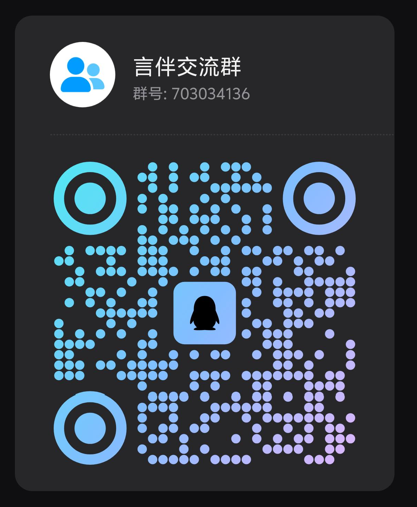
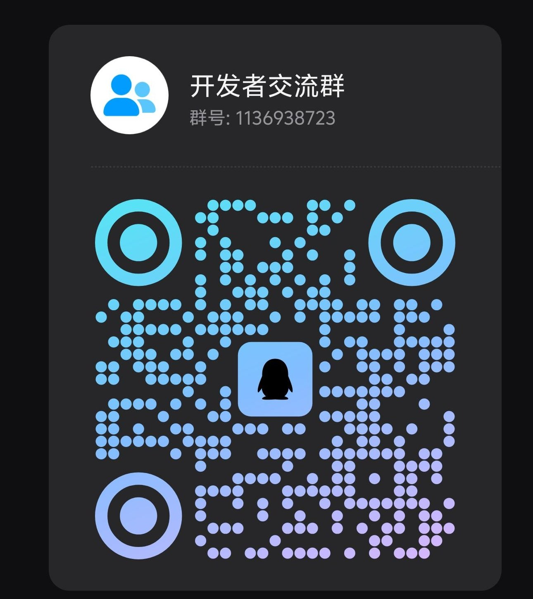
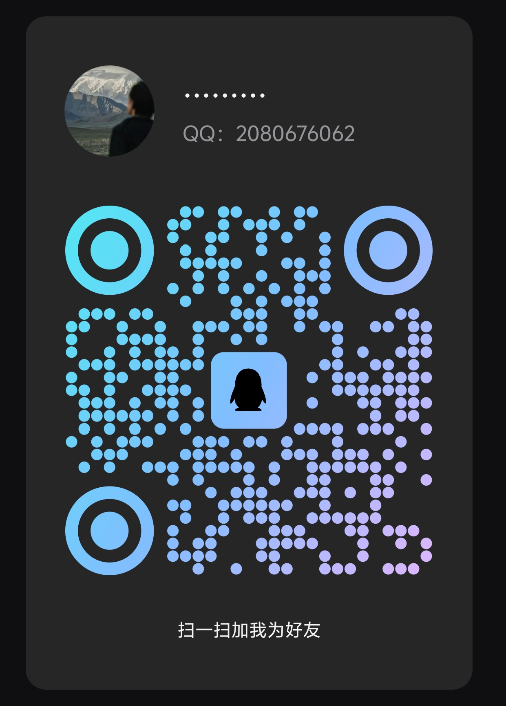

# 言伴

[English](README.en.md) | 简体中文

基于 DeepSeek API 的安卓聊天应用。网页层是 React + rspack，Capacitor 把它装进 Android WebView；没有应用后端，浏览器或客户端直接跟配置好的接口通信。

对话模型可以走 DeepSeek 官方接口，也可以换成任意 Anthropic 兼容端点；语音、文档解析、联网搜索始终使用 DeepSeek 官方接口。

## 交流与支持

**欢迎各地开发者加入开发者交流群**：聊聊模型接入、端点和参数怎么配、提示词怎么写，也欢迎报 bug、提需求，一起把这个 app 打磨得更好用。只想安安静静聊天、看看更新动态的，进言伴交流群就行。

| 言伴交流群 | 开发者交流群 | 加我好友 |
| --- | --- | --- |
|  |  |  |
| QQ 群：703034136 | QQ 群：1136938723 | QQ：2080676062，扫一扫加好友 |

用着有问题、想加功能，或者只是想换个模型，都可以直接找我。不想自己折腾 API Key、端点、模型这些配置也行：提供模型接入服务，把 Key 和端点配好，装上就能用，价格按量计费或按月订阅，具体详谈。

## 招商

中转站、模型服务商欢迎来谈：

- **接入言伴**：你有 Anthropic 兼容端点，想作为可选对话模型接进来，我们来对接配置，把流式、思考模式、附件都测通。
- **服务用户**：想让言伴用户直接填你的地址就能用，可以在文档和群里给出接入方式。
- **了解需求**：想看看这款 app 的用户在用什么模型、缺什么能力，也欢迎来聊。

加开发者交流群，或者直接加我 QQ（2080676062），合作方式与价格详谈。

## 为什么做这个

DeepSeek 官方 App 有额度限制，高峰时段经常排队、回复慢甚至发不出去，用起来很难受。

言伴把同样的对话能力搬到「你自己的 API Key」上：给多少额度由你的账号决定，不再受官方 App 的排队影响；模型还能换成第三方 Anthropic 兼容端点（ModelScope、火山方舟等），挑便宜的、快的用。

## 功能

- 多会话，自动起标题，支持重命名与删除；可编辑提问、重新生成、在分支间切换。
- 流式回复、深度思考开关、停止与继续。
- 智能搜索与网页读取：检索走 DeepSeek Search / Fetch 接口，结果带来源附在本轮对话里。
- 附件：图片直接交给模型；PDF、Word、PPT 由 DeepSeek OCR 转成文本；纯文本与代码在本地读取。
- 语音输入与朗读（ASR / TTS，两种音色）。
- Markdown、代码高亮、KaTeX 公式、Mermaid 图表。
- 中英双语、浅色/深色/跟随系统、手机与桌面布局、历史记录导入导出。
- 应用内检查更新：比对 GitHub Releases 的版本，下载与系统安装交给原生。

## 下载与安装

到 [Releases](https://github.com/JiaMingWang-CN/yanban-chat/releases/latest) 下载最新 APK，直接安装即可。要求 Android 8.0 及以上。

首次安装时系统会提示「未知来源应用」，允许一次就行。装好后打开应用，按提示填写 API Key。

## 配置对话模型

对话走哪个端点由构建期写死的 `provider.config.ts` 决定，普通用户不需要改，下载的包已经配好；想自己换模型的话：

```ts
export const CHAT_PROVIDER = {
  kind: 'anthropic-compatible', // 或 'deepseek'
  baseUrl: 'https://api-inference.modelscope.cn', // 不要带 /v1/messages
  model: 'deepseek-ai/DeepSeek-V4.1-Flash-1017',
  contextWindow: 1048576,
  maxTokens: 393216,
  systemPrompt: '',
}
```

- `kind: 'deepseek'`：对话走 DeepSeek 兼容层，设置里只需要一个 DeepSeek API Key。
- `kind: 'anthropic-compatible'`：对话走第三方端点，设置里会出现两个输入框，分别是第三方对话模型的 Key 和 DeepSeek 的 Key（联网搜索、文档识别仍然要用它）。

**用第三方端点对话时，DeepSeek 官方 Key 只为「调用功能」付费，不为聊天内容付费。** 对话的 token 花在第三方那边（很多端点还有免费额度），官方账号只扣语音、联网搜索、网页读取、文档识别这些辅助能力的调用费，与对话长短无关。

官方当前价格（以 [官方价格页](https://api-docs.deepseek.com/zh-cn/quick_start/pricing) 为准）：

| 能力 | 计费单位 | 价格 |
| --- | --- | --- |
| 联网搜索 Search | 每 1000 次成功请求 | 5 元 |
| 网页读取 Fetch | 每 1000 次成功请求 | 5 元 |
| 文档识别 OCR / 文件解析 | 每 1000 页 | 1.5 元 |
| 语音识别 ASR | 每小时音频 | 0.39 元（限时五折） |
| 语音合成 TTS | 每万字符 | 1.5 元（限时五折） |

也就是说，日常只是对话、偶尔搜一下，一个月的辅助能力花费通常只有几毛到几块钱。

API Key 只在设置里填写，存在浏览器 localStorage，不会进入仓库。

> 如果第三方端点在跨域预检里不允许携带鉴权头，浏览器会直接拒绝请求。安卓端由原生 `StreamHttpPlugin` 发请求绕开这个限制；纯网页部署需要自己加一层代理。

## 自己构建

需要 Node.js 22.12+ 和 pnpm。

```sh
pnpm install
pnpm dev        # http://localhost:8090
pnpm type       # 类型检查
pnpm lint       # lint
pnpm build      # 产出 dist/
```

打安卓包：

```sh
pnpm build
npx cap sync android
cd android && ./gradlew assembleRelease
```

产物在 `android/app/build/outputs/apk/release/`。

签名信息从仓库外读取：`~/.android/yanban-release/signing.properties`（`storeFile`、`storePassword`、`keyAlias`、`keyPassword`）。没有这个文件也能构建，只是产物未签名。

## 数据与隐私

- API Key 与设置项存在浏览器 localStorage，对话与附件原件存在 IndexedDB，都只在本机。
- **错误报告默认关闭，首次使用时会询问是否开启。** 未开启时不会发送任何数据；开启后仅上报错误描述与堆栈、应用版本、平台和界面语言，用于定位和修复问题，不含对话内容、附件、API Key 或任何可识别个人身份的信息。可随时在「设置 → 通用设置」中关闭。
- 发送消息、上传附件、使用语音时，相关内容会发送到所配置的接口服务，属于功能必需。

## 更新

应用内「设置 → 通用设置 → 检查更新」会比对 GitHub Releases 的最新版本，有新版本直接下载并调起系统安装器。1.0.1 及更早的版本没有这个功能，需要手动装一次。

## 目录结构

```
src/
  app/          应用外壳、主题与视口
  components/   界面组件（会话、消息、输入、设置、搜索）
  services/
    api/        协议类型、SSE 解析、第三方端点适配
    chat/       会话存储、请求组装、分支与历史
  i18n/         中英文案
android/        Capacitor Android 工程
```

## 许可

MIT，见 [LICENSE](LICENSE)。本项目衍生自 [deepseek-ai/chat-demo](https://github.com/deepseek-ai/chat-demo)，保留原版权声明。
